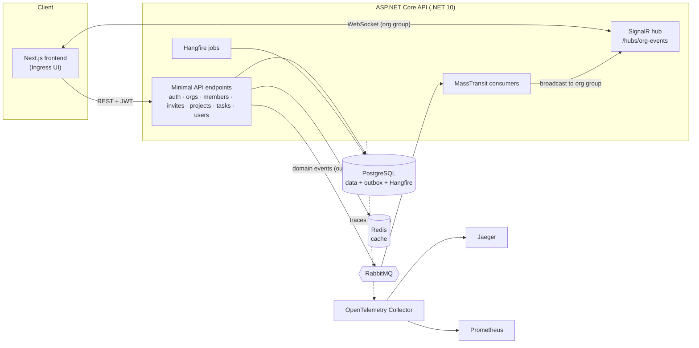

<div align="center">


# Ingress

**Workflow management for organizations — projects, tasks, people and access in one place, updated in real time.**


</div>

---

## Overview

Ingress is a multi-tenant collaboration and workflow platform. Teams create **organizations**, invite people with **role-based access**, organize work into **projects**, and move **tasks** through a board — while every change is pushed live to everyone else in the organization.

It is a full-stack monorepo:

- **Backend** — an ASP.NET Core (.NET 10) minimal API with PostgreSQL, Redis, RabbitMQ/MassTransit, Hangfire, SignalR and OpenTelemetry.
- **Frontend** — a Next.js 16 / React 19 / Tailwind CSS 4 application with a custom enterprise design system.
- **Infrastructure** — Docker Compose for the database, cache, message broker and observability stack (Jaeger + Prometheus).

## Features

### Organizations and access control
- Create isolated organizations; each is its own workspace.
- Three roles enforced by authorization policies: **Owner**, **Admin** and **Member**.
- Members can be promoted, demoted or removed; organization lists are scoped to the signed-in user.

### Invitations
- Owners and admins issue invitation tokens by email with a chosen role.
- Recipients accept with their own account at `/invite/accept`.
- Invitations can be tracked (pending / accepted / revoked) and revoked at any time.

### Projects and tasks
- Projects per organization, each with a delivery-progress summary.
- Task board with **To do / In progress / Done** columns.
- Edit title and description, assign to any member, set or clear due dates; overdue tasks are flagged.

### Dashboard
- Live metrics for members, projects, tasks and overdue work.
- Task status breakdown, members-by-role distribution, invitation summary and a recent-activity feed.

### Real-time collaboration
- Every mutation publishes a domain event to RabbitMQ.
- A MassTransit consumer forwards events to a SignalR hub, grouped by organization.
- The UI subscribes per page, debounces bursts of events and shows the connection state (Connected / Reconnecting / Offline). If the realtime connection is unavailable, the app keeps working with normal requests.

### Security and operations
- JWT access tokens with refresh tokens; the frontend retries once on `401` after refreshing.
- Security headers middleware, request validation with FluentValidation, and consistent problem-details errors.
- Transactional outbox (MassTransit + EF Core) so events are never lost when a write succeeds.
- Health checks for PostgreSQL, Redis and RabbitMQ; traces and metrics via OpenTelemetry.

## Architecture



**Request lifecycle**

1. A user action in the UI calls a typed API client (`frontend/src/lib`).
2. `authFetch` attaches the bearer token and transparently refreshes it on `401`.
3. The API validates the request, checks the caller's organization role, persists the change and writes a domain event to the outbox.
4. The event is published to RabbitMQ; `RealtimeBroadcastConsumer` sends it to the organization's SignalR group.
5. Open pages subscribed to that event type reload their data, so everyone sees the change within moments.

## Backend in depth

The backend follows a layered structure: **Domain** (entities and invariants) → **Application** (repository and unit-of-work interfaces) → **Infrastructure** (EF Core implementations, migrations) → **Api** (endpoints, auth, messaging, realtime).

### Domain model

| Entity | Key fields | Rules |
| --- | --- | --- |
| `User` | email, display name, password hash | Email must be unique |
| `Organization` | name | Name required, trimmed, max 100 characters |
| `OrgMember` | organization, user, role, joined at | Roles: `Owner` > `Admin` > `Member`; removal is a soft delete |
| `OrgMemberAudit` | actor, target, action, from/to role | Records every `Added`, `RoleChanged` and `Removed` |
| `OrgInvitation` | email, role, token, expiry, accepted/revoked by and at | Expires after 7 days; email is normalized |
| `Project` | organization, name | Name 3–120 characters |
| `TaskItem` | project, title, description, status, assignee, due date | Title 3–200, description up to 2,000; status `Todo` / `InProgress` / `Done` |
| `RefreshToken` | user, SHA-256 hash, expiry, revoked, replaced by | Only the hash is stored |

### Permissions

Org-scoped routes are protected by policy-based authorization (`OrgMember`, `OrgAdmin`, `OrgOwner`) that looks up the caller's role from the database, with extra checks inside the endpoints.

| Action | Member | Admin | Owner |
| --- | :---: | :---: | :---: |
| View organization, projects and tasks | ✅ | ✅ | ✅ |
| Create, edit, assign and reschedule tasks | ✅ | ✅ | ✅ |
| Create projects | — | ✅ | ✅ |
| List members, add members | — | ✅ | ✅ |
| Create, list and revoke invitations | — | ✅ | ✅ |
| Invite or add another Owner, revoke an Owner invitation | — | — | ✅ |
| Change roles, remove members | — | — | ✅ |

Safeguards: the last Owner can't be demoted or removed, tasks can only be assigned to organization members, and an invitation can only be accepted by an account whose email matches it.

### Authentication and security

- **Passwords**: PBKDF2-HMAC-SHA256, 100,000 iterations, random 16-byte salt, constant-time comparison.
- **Access tokens**: HS256 JWTs carrying the user id; issuer, audience, lifetime and signing key are validated (30-second clock skew).
- **Refresh tokens**: 32 random bytes, stored only as SHA-256 hashes and **rotated on every refresh** (the old token is revoked and linked to its replacement).
- **Default deny**: a fallback policy requires authentication on every endpoint unless it's explicitly anonymous.
- **Rate limiting**: 100 requests per minute per user (or per IP if anonymous); `/auth/*` is limited to 10 requests per minute per IP. Throttled requests get `429` with a JSON message.
- **Security headers**: `X-Content-Type-Options`, `X-Frame-Options: DENY`, `Referrer-Policy`, `Permissions-Policy`, `Cross-Origin-Opener-Policy`, plus HSTS outside development.
- **Errors**: consistent `application/problem+json` responses; validation via FluentValidation.
- **SignalR**: the access token is accepted from the `access_token` query string, only on the hub route.

### Events and realtime

Writes publish integration events through MassTransit's **EF Core transactional outbox**, so an event is sent only if the database change commits. `RealtimeBroadcastConsumer` relays them to the SignalR group `org:{orgId}` as an `org_event` message `{ type, organizationId, payload, occurredAtUtc }`.

| Event contract | Realtime type |
| --- | --- |
| `OrgInvitationCreated` / `OrgInvitationDeleted` / `OrgInvitationAccepted` | `invite.created` / `invite.revoked` / `invite.accepted` |
| `OrgMemberAdded` / `OrgMemberRoleChanged` / `OrgMemberRemoved` | `member.added` / `member.roleChanged` / `member.removed` |
| `ProjectCreated` | `project.created` |
| `TaskChanged` | `task.{changeType}` (created, status, details, due date, assignment) |

Clients call the hub method `JoinOrg(orgId)`; joining is refused unless the caller is a member. `LeaveOrg(orgId)` unsubscribes.

### Caching, jobs and observability

- **Redis** caches organization member lists (`workflow:org:{orgId}:members`, 2-minute expiry), invalidated on every membership change.
- **Hangfire** (PostgreSQL storage, `hangfire` schema) runs a recurring sample job every minute; `POST /jobs/ping` enqueues one on demand. The dashboard is open in development and requires authentication elsewhere.
- **OpenTelemetry** traces ASP.NET Core, HttpClient, EF Core, Npgsql and Redis, and exports runtime and HTTP metrics plus custom realtime metrics: `realtime_connections_active`, `realtime_connection_events_total`, `realtime_join_events_total`, `realtime_broadcast_events_total`.
- **Health checks**: `/health/live` (process up) and `/health/ready` (PostgreSQL and Redis reachable).
- **Messaging diagnostics**: `POST /messaging/ping` and `POST /messaging/ping-rpc` exercise RabbitMQ publish and request/response.

## Tech stack

| Layer | Technology |
| --- | --- |
| API | ASP.NET Core minimal APIs (.NET 10), FluentValidation, Swagger / OpenAPI |
| Data | Entity Framework Core + PostgreSQL 16 (Npgsql) |
| Cache | Redis 7 (StackExchange.Redis) |
| Messaging | RabbitMQ 3 + MassTransit 8 with EF Core transactional outbox |
| Realtime | ASP.NET Core SignalR (server) / `@microsoft/signalr` (client) |
| Background jobs | Hangfire (PostgreSQL storage) |
| Auth | JWT bearer access tokens + refresh tokens, policy-based org RBAC |
| Observability | OpenTelemetry → Collector → Jaeger (traces) and Prometheus (metrics) |
| Frontend | Next.js 16 (App Router, Turbopack), React 19, TypeScript, Tailwind CSS 4 |
| Testing | xUnit + Testcontainers (backend), Playwright + axe-core (frontend) |

## Repository structure

```text
.
├── src/
│   ├── Workflow.Api/              # HTTP endpoints, auth, SignalR hub, consumers, jobs, Program.cs
│   ├── Workflow.Application/      # Application contracts and use-case logic
│   ├── Workflow.Domain/           # Domain entities and rules
│   └── Workflow.Infrastructure/   # EF Core DbContext, migrations, persistence
├── Workflow.Api.IntegrationTests/ # Backend integration tests (Testcontainers)
├── frontend/                      # Next.js application (Ingress UI)
│   ├── src/app/                   # Routes (App Router)
│   ├── src/components/            # Design system: ui, app shell, dialogs, icons, brand
│   ├── src/lib/                   # API clients, auth, realtime
│   ├── tests/e2e/                 # Playwright end-to-end and accessibility tests
│   └── docs/                      # Frontend command reference and design spec
├── docs/                          # Architecture, stage summaries, command references
├── scripts/                       # Database backup and cleanup helpers
├── docker-compose.yml             # Postgres, Redis, RabbitMQ, API, OTel, Jaeger, Prometheus
├── otel-collector-config.yaml
├── prometheus.yaml
└── RUNBOOK.md                     # Operational commands and checklists
```

## Getting started

### Prerequisites

- [Docker Desktop](https://www.docker.com/products/docker-desktop/) (with Docker Compose)
- [.NET 10 SDK](https://dotnet.microsoft.com/download) — to run the API or tests outside Docker
- [Node.js 20+](https://nodejs.org/) and npm — for the frontend

### 1. Clone

```bash
git clone https://github.com/20Jojo/Ingress.git
cd Ingress
```

### 2. Start the backend

**Option A — everything in Docker (recommended).** Builds the API and starts all services:

```bash
docker compose up -d --build
```

The API is then available at `http://localhost:8080`.

**Option B — infrastructure in Docker, API on your machine** (useful while developing the API):

```bash
docker compose up -d postgres redis rabbitmq otel-collector jaeger prometheus
dotnet run --project src/Workflow.Api/Workflow.Api.csproj
```

The local API listens on `http://localhost:5050`.

Apply database migrations if the schema isn't created yet:

```bash
dotnet ef database update -p src/Workflow.Infrastructure/Workflow.Infrastructure.csproj -s src/Workflow.Api/Workflow.Api.csproj
```

> See [`RUNBOOK.md`](RUNBOOK.md) for a container-based migration fallback and more operational commands.

### 3. Start the frontend

Create `frontend/.env.local` pointing at the API you started:

```env
# Option A (Docker API)
NEXT_PUBLIC_API_BASE_URL=http://localhost:8080
# Option B (local API)
# NEXT_PUBLIC_API_BASE_URL=http://localhost:5050
```

Then:

```bash
cd frontend
npm install
npm run dev
```

Open **http://localhost:3000**. The API's CORS policy allows `localhost:3000`, so keep the frontend on that port.

### 4. Try it out

1. Go to **Create an account** (`/register`) and sign up, then sign in at `/auth`.
2. Open **Organizations** and create one — you become its Owner.
3. Add a project, open its **Tasks** board and create a few tasks.
4. Under **Invitations**, invite a second account, then accept the token from `/invite/accept` while signed in as that user.
5. Open the same organization in two browsers and watch changes appear live.

## Service URLs

| Service | URL |
| --- | --- |
| Ingress frontend | http://localhost:3000 |
| API (Docker / local) | http://localhost:8080 / http://localhost:5050 |
| Swagger UI | http://localhost:8080/swagger |
| Hangfire dashboard | http://localhost:8080/hangfire |
| Health checks | `/health/live`, `/health/ready` |
| RabbitMQ management | http://localhost:15672 |
| Jaeger (traces) | http://localhost:16686 |
| Prometheus (metrics) | http://localhost:9090 |
| PostgreSQL / Redis | `localhost:5432` / `localhost:6379` |

## API reference

All endpoints except `/auth/*` and health checks require `Authorization: Bearer <access token>`. Organization-scoped endpoints additionally require membership and, where noted, an Admin or Owner role. Full schemas are available in Swagger.

| Area | Method & route | Purpose |
| --- | --- | --- |
| Auth | `POST /auth/register` | Create an account |
| | `POST /auth/login` | Obtain access + refresh tokens |
| | `POST /auth/refresh` | Exchange a refresh token for new tokens |
| | `POST /auth/logout` | Revoke a refresh token |
| Users | `GET /users` | The signed-in user's own record |
| | `GET /users/{userId}` | Fetch a user by id |
| Organizations | `GET /orgs`, `POST /orgs` | List your organizations / create one |
| | `GET /orgs/{orgId}` | Organization details |
| Members | `GET /orgs/{orgId}/members` | List members (cached in Redis for 2 minutes) |
| | `POST /orgs/{orgId}/members` | Add an existing user directly |
| | `PATCH /orgs/{orgId}/members/{userId}/role` | Change a member's role |
| | `DELETE /orgs/{orgId}/members/{userId}` | Remove a member |
| Invitations | `GET /orgs/{orgId}/invitations`, `POST /orgs/{orgId}/invitations` | List / create invitations |
| | `DELETE /orgs/{orgId}/invitations/{invitationId}` | Revoke an invitation |
| | `POST /invitations/{token}/accept` | Accept an invitation |
| Projects | `GET /orgs/{orgId}/projects`, `POST /orgs/{orgId}/projects` | List / create projects |
| | `GET /orgs/{orgId}/projects/{projectId}` | Project details |
| Tasks | `GET /projects/{projectId}/tasks`, `POST /projects/{projectId}/tasks` | List / create tasks |
| | `GET /tasks/{taskId}` | Task details |
| | `PATCH /tasks/{taskId}/status` | Change status (`Todo`, `InProgress`, `Done`) |
| | `PATCH /tasks/{taskId}/assign` | Assign or unassign |
| | `PATCH /tasks/{taskId}/due` | Set or clear the due date |
| | `PUT /tasks/{taskId}/details` | Update title and description |
| Realtime | `/hubs/org-events` (SignalR) | Join an organization group and receive `org_event` messages such as `task.*`, `member.*`, `invite.*`, `project.*` |

## Frontend

The Ingress UI lives in [`frontend/`](frontend). Highlights:

- **Design system** — shared tokens and components (`frontend/src/components`) give every page the same structure: a grouped sidebar, breadcrumbs, a consistent page header, tables, cards, dialogs and toasts. The visual language — turquoise, aqua and white, set in Plus Jakarta Sans and Inter — is documented in [`frontend/docs/enterprise-ui-design-spec.md`](frontend/docs/enterprise-ui-design-spec.md).
- **Routes**

  | Route | Page |
  | --- | --- |
  | `/` | Home and getting started |
  | `/auth`, `/register` | Sign in / create account |
  | `/invite/accept` | Accept an invitation |
  | `/orgs` | Organizations |
  | `/orgs/[orgId]` | Organization overview |
  | `/orgs/[orgId]/dashboard` | Live dashboard |
  | `/orgs/[orgId]/projects` | Projects |
  | `/orgs/[orgId]/projects/[projectId]` | Project summary |
  | `/orgs/[orgId]/projects/[projectId]/tasks` | Task board |
  | `/orgs/[orgId]/projects/[projectId]/tasks/[taskId]` | Task details |
  | `/orgs/[orgId]/members` | Members and roles |
  | `/orgs/[orgId]/invite` | Invitations |
  | `/users` | Your account (the API returns only the signed-in user) |
  | `/ping` | API status |

- **Useful scripts** (run inside `frontend/`)

  | Command | What it does |
  | --- | --- |
  | `npm run dev` | Start the dev server |
  | `npm run build` / `npm start` | Production build / serve it |
  | `npm run verify` | Lint + type-check |
  | `npm run verify:full` | Lint + type-check + production build |
  | `npm run e2e` | Playwright end-to-end tests |
  | `npm run e2e:a11y` | Accessibility audit (axe-core, WCAG A/AA) |

## Testing

**Backend integration tests** spin up real PostgreSQL, Redis and RabbitMQ containers with Testcontainers (Docker must be running):

```bash
dotnet test Workflow.Api.IntegrationTests/Workflow.Api.IntegrationTests.csproj
```

They cover auth and protected endpoints, organization scoping and RBAC, invitation acceptance, task permissions, and realtime propagation through SignalR.

**Frontend end-to-end tests** run against a live backend:

```bash
cd frontend
npx playwright install
npm run e2e        # smoke, org → project → task, invite + role change flows
npm run e2e:a11y   # accessibility audit on key pages
```

## Configuration

The API reads standard ASP.NET Core configuration (`appsettings*.json` or environment variables using `__` as the separator):

| Setting | Purpose |
| --- | --- |
| `ConnectionStrings__WorkflowDb` | PostgreSQL connection string |
| `ConnectionStrings__Redis` | Redis endpoint |
| `ConnectionStrings__RabbitMq` | RabbitMQ AMQP URI |
| `Jwt__Issuer`, `Jwt__Audience` | Token issuer and audience |
| `Jwt__SigningKey` | Symmetric signing key (at least 32 characters) |
| `Jwt__AccessTokenMinutes`, `Jwt__RefreshTokenDays` | Token lifetimes |
| `OpenTelemetry__ServiceName`, `OpenTelemetry__OtlpEndpoint` | Telemetry export |

The frontend needs a single variable: `NEXT_PUBLIC_API_BASE_URL`.

> **Security note:** the credentials and JWT signing key in `docker-compose.yml` are local-development defaults. Replace them with secrets from your environment or a secret store before deploying anywhere else.

## Documentation

| Document | Contents |
| --- | --- |
| [`RUNBOOK.md`](RUNBOOK.md) | Start/stop, logs, health checks, migrations, readiness checklist |
| [`docs/current-architecture.md`](docs/current-architecture.md) | Architecture and the stage-by-stage build history |
| [`docs/command-index.md`](docs/command-index.md) | Index of all command references |
| [`docs/backend-command-reference.md`](docs/backend-command-reference.md) | Backend commands explained |
| [`frontend/docs/command-reference.md`](frontend/docs/command-reference.md) | Frontend commands explained |
| [`frontend/docs/enterprise-ui-design-spec.md`](frontend/docs/enterprise-ui-design-spec.md) | Ingress design system |

## Troubleshooting

- **"Realtime: Offline" in the top bar** — the frontend can't reach the SignalR hub. Make sure the API and RabbitMQ are running and `NEXT_PUBLIC_API_BASE_URL` points at the right port. The rest of the app still works; data refreshes on navigation or with **Reload**.
- **CORS errors in the browser** — run the frontend on `http://localhost:3000`, which is the origin the API allows.
- **`401 Unauthorized` everywhere** — your session expired or the API's JWT settings changed; sign in again at `/auth`.
- **Migrations fail locally** — use the container-based fallback in [`RUNBOOK.md`](RUNBOOK.md).

## Author

Built by **Joel Masoso** ([@20Jojo](https://github.com/20Jojo)).
